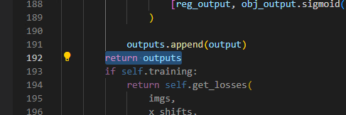
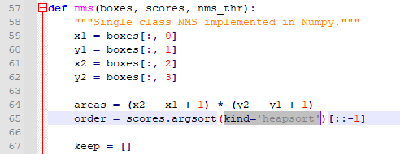
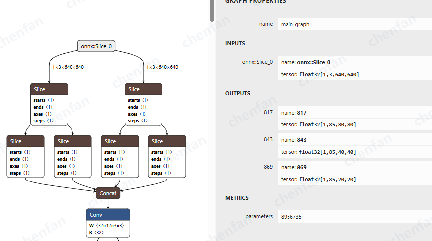

# onnx 模型导出说明

Github工程地址：https://github.com/ultralytics/ultralytics

pth 模型转换为onnx 需要依赖模型定义代码，

1） 需修改yolox/models/yolo_head.py
如下图所示

2） 需修改yolox/utils/demo_utils.py
如下图所示

导出后为3路输出，示例如下

# 量化数据准备说明

由于yoloxs 数据预处理和 常用的yolov5/v8有差异，因此需要先准备量化数据

python make_image_input.py \
    --input /data/dataset/coco_random_10 \
    --outpath /data/model_convert/yoloxs/quant_data

input : 量化图像的目录
outpath : 输出bin数据目录